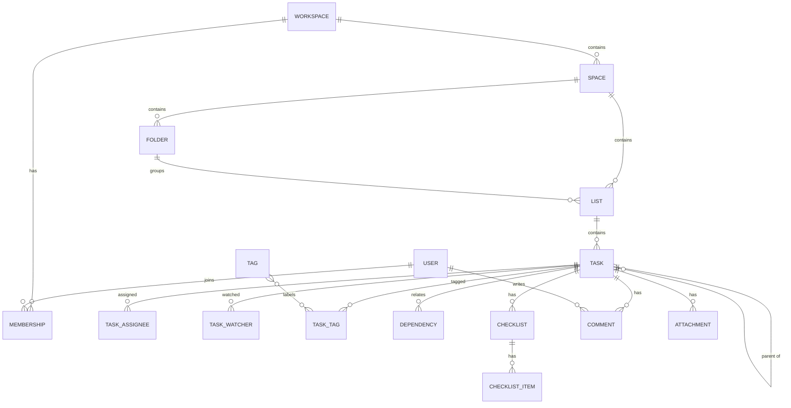

# 02 – Data Model

Relational model (PostgreSQL). All tables carry `id` (UUIDv7), `created_at`, `updated_at`,
and — for tenant data — `workspace_id`. Soft-delete via `deleted_at` where recovery matters.

Conventions: money as `numeric(18,2)` + `currency`; durations as `bigint` milliseconds; user-
editable rich text stored as structured JSON (ProseMirror-style) plus a plain-text projection
used for search; flexible/config blobs as `jsonb`.

## Hierarchy & identity

| Entity | Key fields |
|--------|-----------|
| `workspace` | name, slug, plan, default_locale, direction, calendar (`jalali`/`gregorian`), week_start (`sat`), timezone (`Asia/Tehran`), storage_used, storage_quota |
| `user` | email, name, locale, timezone, avatar_ref, billable_rate, capacity_hours_per_day |
| `membership` | workspace_id, user_id, role (`owner`/`admin`/`member`/`guest`), status |
| `team` / `team_member` | named user groups |
| `space` | workspace_id, name, color, is_private, archived_at |
| `folder` | space_id, name, position, archived_at |
| `list` | space_id, folder_id?, name, status_set_id, default_assignee_id, settings (jsonb) |
| `status_set` / `status` | status_set_id, name, type (`open`/`custom`/`done`/`closed`), color, position |
| `task` | list_id, parent_task_id?, title, description_json, description_text, status_id, priority, start_date, due_date, completed_at, estimate_ms, time_spent_ms, created_by, position, recurrence_rule?, archived_at |
| `task_assignee` | task_id, assignee_type (`user`/`team`), assignee_id, estimate_ms (per-assignee estimate) |
| `task_watcher` | task_id, user_id |
| `tag` / `task_tag` | tag(name,color); task_tag(task_id, tag_id) |
| `dependency` | task_id, depends_on_task_id, type (`blocks`/`blocked_by`/`waiting_on`) |
| `checklist` / `checklist_item` | checklist_item(text, done, assignee_id) |
| `comment` | task_id, author_id, body_json, body_text, parent_comment_id?, resolved_at |
| `attachment` | owner_type/owner_id, filename, mime, size, storage_key, checksum, uploaded_by |

## Custom fields

| Entity | Key fields |
|--------|-----------|
| `custom_field` | scope (`workspace`/`space`/`folder`/`list`), scope_id, name, type, config (jsonb), required, position |
| `custom_field_value` | task_id, field_id, value (jsonb) — unique(task_id, field_id) |

Field `type` enum: `text`, `long_text`, `number`, `currency`, `dropdown`, `labels`, `checkbox`,
`date`, `email`, `phone`, `url`, `files`, `rating`, `progress` (auto), `formula`, `rollup`,
`relationship` (links tasks), `users`, `location`.

- `formula`: `config.expression` evaluated over numeric fields/rollups.
- `rollup`: `config { source_field, relation, aggregation }`.
- `progress`: computed from subtask completion or a numeric field.

## Views & dashboards

| Entity | Key fields |
|--------|-----------|
| `view` | scope (`list`/`folder`/`space`/`everything`), scope_id, name, type, config (jsonb: filters, sort, group, columns, zoom, capacity), created_by, is_shared, is_default |
| `dashboard` | scope, scope_id, name, layout (jsonb), is_shared |
| `widget` | dashboard_id, type (`number`/`bar`/`line`/`pie`/`table`/`embed`/`goal`), config (jsonb: data source, filters, period) |
| `saved_filter` | scope, scope_id, name, filter (jsonb) |

`view.type` enum: `list`, `board`, `calendar`, `gantt`, `timeline`, `workload`, `table`, `activity`.

## Time tracking

| Entity | Key fields |
|--------|-----------|
| `time_entry` | task_id?, user_id, description, start_at, end_at, duration_ms, billable, rate_amount, currency, approved, source (`manual`/`timer`/`automation`/`import`), timesheet_id? |
| `active_timer` | user_id (unique), task_id, started_at, description, billable |
| `timesheet` | user_id, period_start, period_end, status (`draft`/`submitted`/`approved`/`rejected`), submitted_at, approved_by, rejection_reason |
| `rate_rule` | scope_type/scope_id, user_id?, amount, currency (resolution: task/list → user → workspace) |

## Focus sessions (core time primitive)

| Entity | Key fields |
|--------|-----------|
| `focus_profile` | user_id (unique), focus_points, streak_count, last_result, grid_width, grid_height |
| `focus_session` | user_id, task_id?, duration_minutes, status (`running`/`paused`/`completed`/`failed`/`cancelled`), started_at, ended_at, points_earned, interruption_reason |
| `focus_grid_node` | user_id, session_id? (unique), x, y, type (`residential`/`landmark`/`park`), status (`blueprint`/`constructed`/`ruin`), duration_minutes; unique(user_id, x, y) |

A completed focus session is the primary source of tracked time; `time_entry` is reserved for
manual entries and future billable exports.

## Goals & targets

| Entity | Key fields |
|--------|-----------|
| `goal` | scope (`workspace`/`space`), scope_id, folder_id?, name, period_type (`month`/`quarter`/`custom`), period_start, period_end, status, owners |
| `target` | goal_id, name, type (`number`/`currency`/`task_completion`/`boolean`), unit, start_value, target_value, current_value, weight |
| `target_task` | target_id, task_id (explicit links); tag/list-based targets resolve dynamically |

Progress rule: `goal.progress = Σ(target.weight × target.progress) / Σ(target.weight)`,
where `task_completion.progress = completed_linked_tasks / total_linked_tasks`.

## Automations

| Entity | Key fields |
|--------|-----------|
| `automation` | scope, scope_id, name, enabled, version, trigger (jsonb), conditions (jsonb), actions (jsonb), created_by, run_as (`owner`/`actor`) |
| `automation_run` | automation_id, triggered_by_event, status (`success`/`failed`/`skipped`/`looped`), duration_ms, log (jsonb), created_at |

## AI module

| Entity | Key fields |
|--------|-----------|
| `ai_source` | scope, scope_id, type (`file`/`url`/`text`/`list`/`task`), storage_ref?, indexed_at, status |
| `ai_chunk` | source_id, content, embedding (`vector`), metadata (jsonb), position |
| `ai_conversation` / `ai_message` | conversation scope; message role (`user`/`assistant`), content, citations (jsonb), tokens |
| `ai_job` | type (`ask`/`summarize`/`generate_subtasks`/`generate_content`/`translate`), input (jsonb), output (jsonb), status, model, tokens_used |

Embeddings use `pgvector`; vector index per locale namespace so Persian chunks rank correctly.

## Notifications, activity, files

| Entity | Key fields |
|--------|-----------|
| `notification` | user_id, type, payload (jsonb), read_at, channel (`in_app`/`email`) |
| `subscription_pref` | user_id, event_type, enabled, channel |
| `activity` | workspace_id, actor_id, entity_type/entity_id, action, diff (jsonb) |
| `attachment` (shared) | see hierarchy section; storage is a plan-level policy |

## Indexes & integrity (highlights)

- `task(list_id, position)`, `task(parent_task_id)`, `task(due_date)`, `task(status_id)`.
- `custom_field_value(field_id, value jsonb_path_ops)` for filtering.
- `time_entry(user_id, start_at)`, `time_entry(task_id)`, `time_entry(timesheet_id)`.
- `target_task(task_id)` and `target(goal_id)` for live goal roll-ups.
- `ai_chunk` HNSW vector index.
- FK `on delete` rules: cascade for owned children, `restrict` for cross-tenant links.

## Migration & seed

- Migrations via Prisma (or equivalent); every tenant table indexed on `workspace_id`.
- Seed data: a demo workspace, one space, three lists, status sets, sample tasks, a Gantt and a
  Workload view, a sample automation, a sample goal — all with Persian labels.
